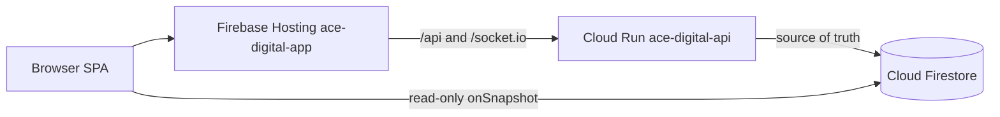

# Ace Digital OS production architecture

Cloud Firestore is the production source of truth. The Cloud Run API writes every record there when `USE_FIRESTORE=true`. PostgreSQL is for local development only.

The employee web app is Firebase Hosting site `ace-digital-app`, meant for `https://app.acedigital.cc`. The apex domain `https://acedigital.cc` is the public marketing website and must not serve this SPA.

## Live services

| Surface | URL |
|---------|-----|
| Web app (after the owner creates the site) | https://app.acedigital.cc and https://ace-digital-app.web.app |
| REST and Socket.IO | Same origin, Hosting rewrite to Cloud Run `ace-digital-api` in `asia-south1` |
| Health check | https://ace-digital-app.web.app/api/healthz |
| Marketing site (not this app) | https://acedigital.cc |

`https://ace-digital-os.web.app` was a previous documented host and was returning Firebase “Site Not Found” when last checked. New deploys go to the `ace-digital-app` target in `.firebaserc`.

## Architecture



- Cloud Run handles authenticated REST and Socket.IO. Minimum instances are 0. Billing is request-based.
- Firestore is the source of truth for users, tasks, payroll, chat, and the rest of the API data.
- Client Firestore writes are denied by rules. Chat members can read mirrored messages.
- Chat persistence does not need Redis. A message is written inline unless `REDIS_URL` is set.

## Deploy

Do this only after Secret Manager has `JWT_SECRET` and the Cloud Run service exists before the Hosting deploy. Exact commands: [DEPLOY_CLOUD_RUN.md](DEPLOY_CLOUD_RUN.md).

```bash
ACE_DEPLOY_CLOUD_RUN=1 pnpm run deploy:cloud-run
pnpm run deploy:hosting
```

`pnpm run deploy:hosting` builds the SPA without `VITE_API_BASE_URL` and deploys Hosting target `ace-digital-app`.

## Expected monthly cost (12 people)

Prices below are from the Cloud Run request-based table on [cloud.google.com/run/pricing](https://cloud.google.com/run/pricing) (checked 23 Oct 2026). `asia-south1` is Tier 1. The free tier is a spending discount at Tier 1 prices, shared by the billing account: **180,000 vCPU-seconds**, **360,000 GiB-seconds**, and **2 million requests** per month. Active CPU is **$0.000024 per vCPU-second**. Active memory is **$0.0000025 per GiB-second**.

| Workload | Rough result |
|----------|----------------|
| Daytime bursts, chat not left open. Order of tens of thousands of sub-second requests. | Inside the free quota. **About $0** for Cloud Run. |
| 12 people leave one shared chat socket up ~6 hours × 20 weekdays (one 1 vCPU instance, concurrency 80). 432,000 vCPU-seconds. | Past the 180,000 free seconds. About **$6** of CPU. 512Mi memory for that time stays inside 360,000 GiB-seconds. |
| Same pattern for ~8 hours × 22 weekdays. | About **$11** of CPU. |

Firestore, Hosting, and the push Cloud Functions for this team stay inside their own free quotas. Cloud Build’s daily free minutes cover an occasional image build. Artifact Registry’s free storage covers one small image; above that it is cents.

Egress from Mumbai is not the North America 1 GiB free tier. JSON for this team is usually well under $1. Downloads of ID cards and HR files through the API can add more.

**Blaze is required** to create Cloud Run. Linking billing upgrades Spark to Blaze. There is no flat Blaze fee. The bill is usage above free tier.

Set a [budget alert at $10](https://console.cloud.google.com/billing/budgets?project=ace-digital-os) so mail goes out before a surprise. Use an alert, not a hard spend cap. A spend cap pauses Cloud Run and the API returns 5xx until the next month or until someone lifts the cap.

## Verify

1. Check `https://ace-digital-app.web.app/api/healthz` after Hosting is deployed.
2. Log in at `https://app.acedigital.cc` (or `https://ace-digital-app.web.app` before DNS).
3. Send a channel message.
4. Confirm a second authenticated browser receives the update without refreshing.

See [DEPLOY_CLOUD_RUN.md](DEPLOY_CLOUD_RUN.md), [CHAT.md](CHAT.md), and [RENDER_KEEPALIVE_CRON.md](RENDER_KEEPALIVE_CRON.md).
