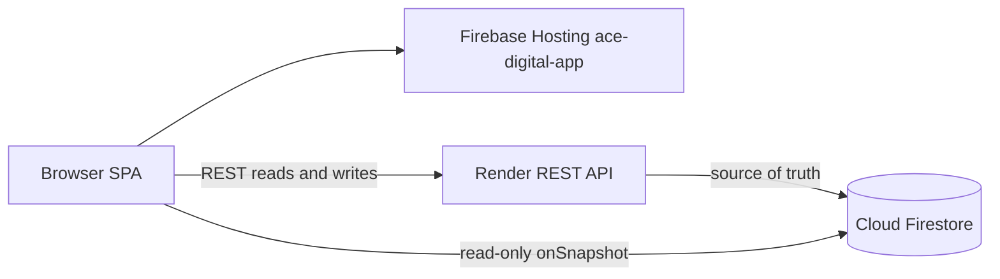

# Ace Digital OS production architecture

Cloud Firestore is the production source of truth. The Render API writes every record there when `USE_FIRESTORE=true`. PostgreSQL is for local development only.

The employee web app is its own Firebase Hosting site, `ace-digital-app`, meant for `https://app.acedigital.cc`. The apex domain `https://acedigital.cc` is the public marketing website and must not serve this SPA.

## Live services

| Surface | URL |
|---------|-----|
| Web app (after the owner creates the site) | https://app.acedigital.cc and https://ace-digital-app.web.app |
| REST API | https://ace-digital-api.onrender.com |
| Health check | https://ace-digital-api.onrender.com/api/healthz |
| Marketing site (not this app) | https://acedigital.cc |

`https://ace-digital-os.web.app` was the previous documented host and was returning Firebase “Site Not Found” when last checked. New deploys go to the `ace-digital-app` target in `.firebaserc`.

## Architecture



- Render handles authenticated REST requests.
- Firestore is the source of truth for users, tasks, payroll, chat, and the rest of the API data.
- Client Firestore writes are denied by rules. Chat members can read mirrored messages.

## Deploy the web app

Do this only after the Hosting site exists. Creating the site and DNS is an owner step; see [FIREBASE.md](../FIREBASE.md).

```bash
pnpm run build:web:render
npx firebase-tools@latest deploy --only hosting:ace-digital-app,firestore:rules,firestore:indexes,storage --project ace-digital-os
```

`pnpm run deploy:hosting:render` builds the SPA with `VITE_API_BASE_URL=https://ace-digital-api.onrender.com` and deploys Hosting target `ace-digital-app`.

Render auto-deploys the API from the connected repository using `render.yaml`. That file sets `APP_URL` and `APP_LOGIN_URL` to `https://app.acedigital.cc`. Apply the blueprint, or set those variables in the Render dashboard, before links in email point at the new host.

## Verify

1. Check `https://ace-digital-api.onrender.com/api/healthz`.
2. Log in at `https://app.acedigital.cc` (or `https://ace-digital-app.web.app` before DNS).
3. Send a channel message.
4. Confirm a second authenticated browser receives the update without refreshing.

See [DEPLOY_RENDER.md](DEPLOY_RENDER.md), [CHAT.md](CHAT.md), and [RENDER_KEEPALIVE_CRON.md](RENDER_KEEPALIVE_CRON.md).
