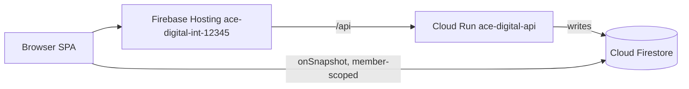

# Ace Digital OS production architecture

Cloud Firestore is the production source of truth. The Cloud Run API writes every record there when `USE_FIRESTORE=true`. PostgreSQL is for local development only.

The employee web app is the default Firebase Hosting site `ace-digital-int-12345` in project `ace-digital-int-12345` (display name Ace Digital Int), meant for `https://app.acedigital.cc`. The apex domain `https://acedigital.cc` is the public marketing website and must not serve this SPA. A second site named `ace-digital-app` is not used.

## Live services

| Surface | URL |
|---------|-----|
| Web app | https://app.acedigital.cc, https://ace-digital-int-12345.web.app, and https://ace-digital-int-12345.firebaseapp.com |
| REST API | Same origin `/api`, Hosting rewrite to Cloud Run `ace-digital-api` in `asia-south1` |
| Health check | https://ace-digital-int-12345.web.app/api/healthz |
| Marketing site (not this app) | https://acedigital.cc |

Project id is `ace-digital-int-12345`. Firestore in that project starts empty. Create the owner with `bootstrap:owner` before asking anyone to log in. See [FIREBASE.md](../FIREBASE.md).

## Architecture



- Cloud Run handles authenticated REST. Minimum instances are 0. Billing is request-based. Chat does not open a WebSocket, so an open chat page does not keep an instance alive.
- Firestore is the source of truth for users, tasks, payroll, chat, attendance, and the rest of the API data. Daily attendance is computed when the roster or summary is read. There is no attendance cron and no always-on instance. See [ATTENDANCE.md](ATTENDANCE.md).
- The API mints a Firebase custom token at login. Security rules allow a signed-in member to read `channels/{id}` and `channels/{id}/messages`, and deny client writes. Sends stay on `POST /api/v1/channels/:id/messages`.
- If the custom token cannot be minted, the chat page polls every 5 seconds while the tab is visible and pauses while it is hidden.
- Chat persistence does not need Redis. A message is written inline unless `REDIS_URL` is set.

## Deploy

Do this only after Secret Manager has `JWT_SECRET` and the Cloud Run service exists before the Hosting deploy. Exact commands: [DEPLOY_CLOUD_RUN.md](DEPLOY_CLOUD_RUN.md).

```bash
ACE_DEPLOY_CLOUD_RUN=1 pnpm run deploy:cloud-run
pnpm run deploy:hosting
```

`pnpm run deploy:hosting` builds the SPA without `VITE_API_BASE_URL` and deploys the default Hosting site `ace-digital-int-12345`. Pass `VITE_FIREBASE_API_KEY`, `VITE_FIREBASE_APP_ID`, and `VITE_FIREBASE_MESSAGING_SENDER_ID` from `firebase apps:sdkconfig` so chat can use Firestore listeners. Without those, chat polls.

## Expected monthly cost (12 people)

Prices below are from the Cloud Run request-based table on [cloud.google.com/run/pricing](https://cloud.google.com/run/pricing) (checked 23 Oct 2026). `asia-south1` is Tier 1. The free tier is a spending discount at Tier 1 prices, shared by the billing account: **180,000 vCPU-seconds**, **360,000 GiB-seconds**, and **2 million requests** per month. Active CPU is **$0.000024 per vCPU-second**. Active memory is **$0.0000025 per GiB-second**.

| Workload | Rough result |
|----------|----------------|
| Daytime use for 12 people. Chat listeners are Firestore reads. API calls are short (send, login, page loads). | Inside the free quota. **About $0.** An open chat page does not hold a Cloud Run instance. |

Firestore, Hosting, and the push Cloud Functions for this team stay inside their own free quotas. Cloud Build’s daily free minutes cover an occasional image build. Artifact Registry’s free storage covers one small image; above that it is cents.

Egress from Mumbai is not the North America 1 GiB free tier. JSON for this team is usually well under $1. Downloads of ID cards and HR files through the API can add more.

**Blaze is required** to create Cloud Run. Linking billing upgrades Spark to Blaze. There is no flat Blaze fee. The bill is usage above free tier.

Set a [budget alert at $10](https://console.cloud.google.com/billing/budgets?project=ace-digital-int-12345) so mail goes out before a surprise. Use an alert, not a hard spend cap. A spend cap pauses Cloud Run and the API returns 5xx until the next month or until someone lifts the cap.

## Verify

1. Check `https://ace-digital-int-12345.web.app/api/healthz` after Hosting is deployed.
2. Log in at `https://app.acedigital.cc` (or `https://ace-digital-int-12345.web.app` before DNS) as the user created by `bootstrap:owner`.
3. Send a channel message.
4. Confirm a second authenticated browser receives the update without refreshing.

See [DEPLOY_CLOUD_RUN.md](DEPLOY_CLOUD_RUN.md), [CHAT.md](CHAT.md), and [RENDER_KEEPALIVE_CRON.md](RENDER_KEEPALIVE_CRON.md).
